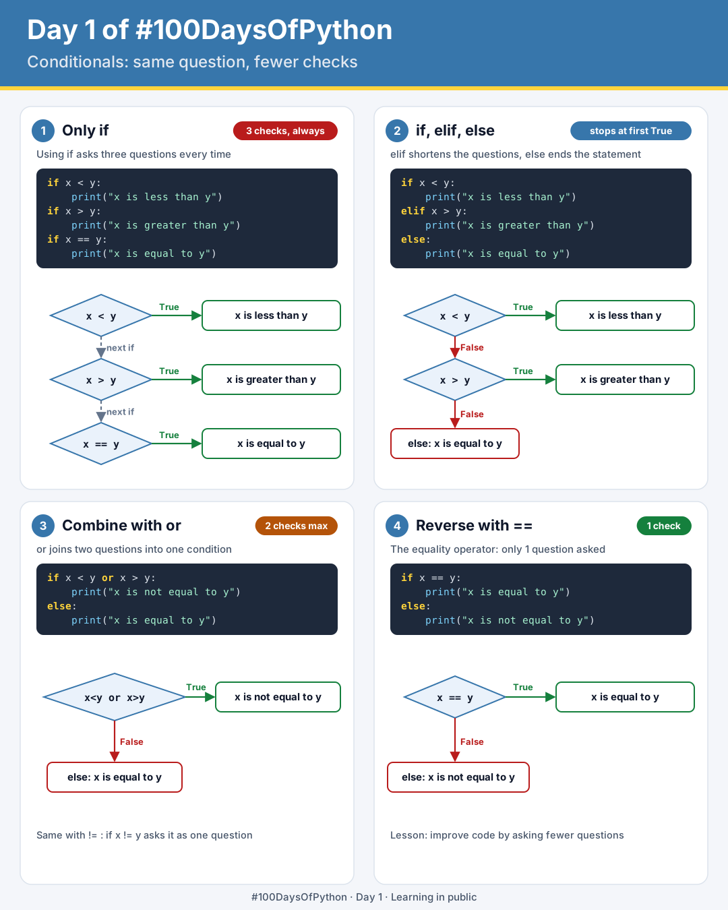
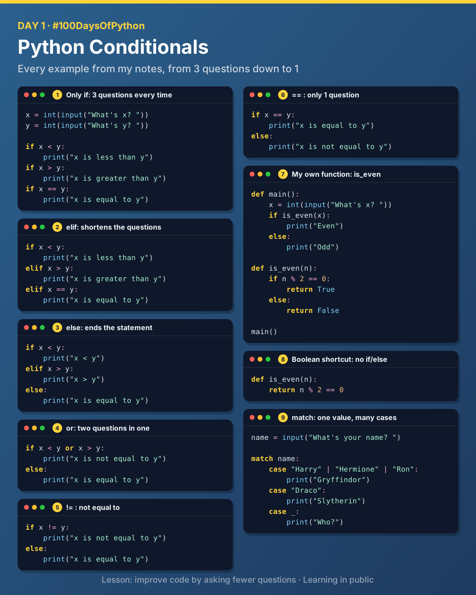

# Day 1: Conditionals

Today I learnt about conditionals: the ability to ask questions in code and answer them. The main lesson: **improve your code by asking fewer questions.**



## Symbols for asking questions

| Symbol | Meaning |
|--------|---------|
| `>` | Greater than |
| `>=` | Greater than or equal to |
| `<` | Less than |
| `<=` | Less than or equal to |
| `==` | Equality |
| `!=` | Not equal to |
| `=` | Assignment (stores a value, does not ask a question) |

## Keywords for asking questions

`if`, `elif`, `else`, `or`, `and`

## Comparing two numbers, six ways

Each version below compares `x` and `y`. They get better as they ask fewer questions.

| File | Approach | Questions asked |
|------|----------|-----------------|
| [`01_compare_if.py`](./01_compare_if.py) | Only `if` | Always 3 |
| [`02_compare_elif.py`](./02_compare_elif.py) | `if` / `elif` | Stops at the first True |
| [`03_compare_else.py`](./03_compare_else.py) | `if` / `elif` / `else` | Up to 2 |
| [`04_compare_or.py`](./04_compare_or.py) | `or` | One combined condition |
| [`05_compare_not_equal.py`](./05_compare_not_equal.py) | `!=` | 1 |
| [`06_compare_equal.py`](./06_compare_equal.py) | `==` | 1 |

### 1. Only if

Using only `if` asks three questions every time.

```python
if x < y:
    print("x is less than y")
if x > y:
    print("x is greater than y")
if x == y:
    print("x is equal to y")
```

### 2. elif

The flow above is repetitive. `elif` shortens the questions.

```python
if x < y:
    print("x is less than y")
elif x > y:
    print("x is greater than y")
elif x == y:
    print("x is equal to y")
```

### 3. else

`else` ends the statement.

```python
if x < y:
    print("x is less than y")
elif x > y:
    print("x is greater than y")
else:
    print("x is equal to y")
```

### 4. or

`or` joins two questions into one.

```python
if x < y or x > y:
    print("x is not equal to y")
else:
    print("x is equal to y")
```

### 5. != (not equal to)

```python
if x != y:
    print("x is not equal to y")
else:
    print("x is equal to y")
```

### 6. == (equality operator)

Reversing the code with `==` means only 1 question is asked.

```python
if x == y:
    print("x is equal to y")
else:
    print("x is not equal to y")
```

> **Note:** It's better to make conditions mutually exclusive, so you avoid each and every question getting an answer, as happens when you only use `if`.

## Inventing my own function

A problem-solving technique: write a `main` function and naively assume the function you need already exists.

Example: a function to check if a number is even ([`07_parity.py`](./07_parity.py)).

1. Create the `main` function
2. Assume `is_even` exists and use it in `main`
3. Write `is_even` outside of `main`
4. Call `main`

```python
def main():
    x = int(input("What's x? "))
    if is_even(x):
        print("Even")
    else:
        print("Odd")


def is_even(n):
    if n % 2 == 0:
        return True
    else:
        return False


main()
```

### Boolean shortcut

For boolean values (True or False) there's no need to use `if` and `else`, because the comparison already returns True or False ([`08_parity_boolean.py`](./08_parity_boolean.py)):

```python
def is_even(n):
    return n % 2 == 0
```

## match

`match` checks one value against several cases ([`09_house.py`](./09_house.py)). `|` means "or" inside a case and `_` catches everything else.

```python
name = input("What's your name? ")

match name:
    case "Harry" | "Hermione" | "Ron":
        print("Gryffindor")
    case "Draco":
        print("Slytherin")
    case _:
        print("Who?")
```

## All code at a glance



## Key takeaways

- Always look for ways to improve code by asking fewer questions.
- Make conditions mutually exclusive with `elif` and `else`.
- Write `main` first and assume helper functions exist, then build them.
- Return boolean expressions directly instead of wrapping them in `if`/`else`.

---

[Back to all days](../README.md)
