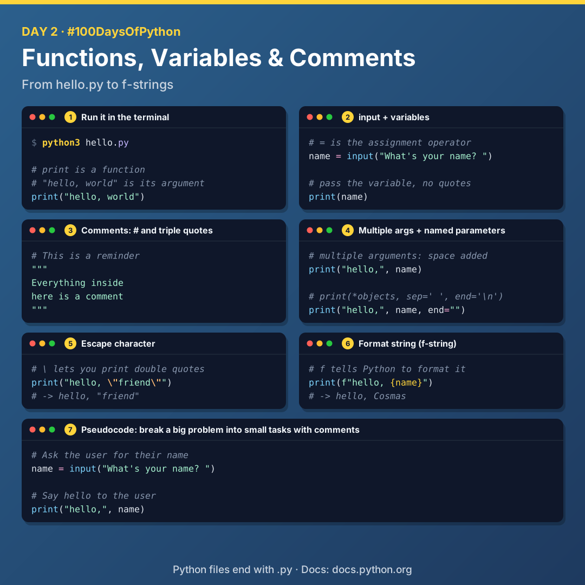
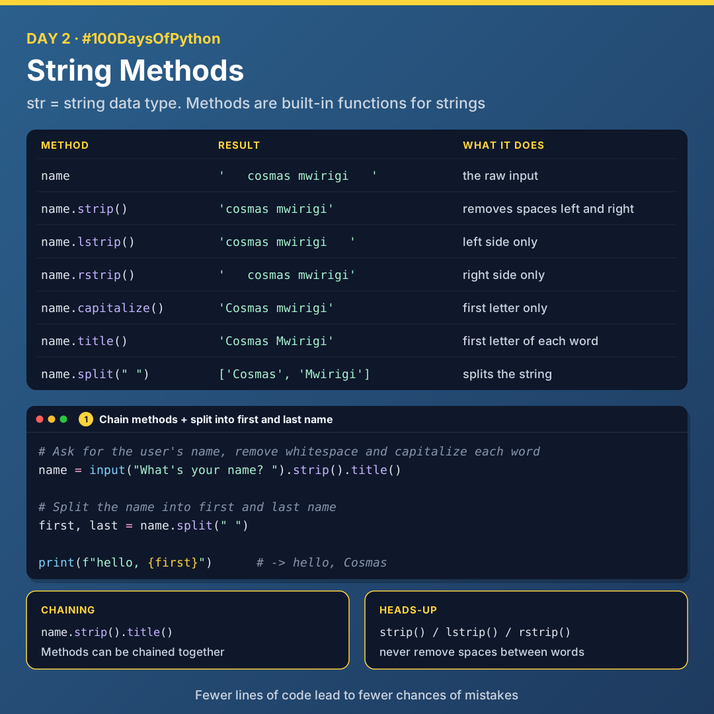

# Day 2: Functions, Variables and Strings

Today I went back to the foundations: how to run a Python program, functions and arguments, variables, comments, format strings and string methods.



## Running a Python program

- Python files end with `.py`.
- To run a program, use the `python` command followed by the file name in the terminal. The latest command is `python3`.

```bash
python3 hello.py
```

Code is best written in a text editor such as **VS Code**, which has built-in tools like a terminal, coloured syntax, extensions and an AI assistant.

## Key terms

| Term | Meaning |
|------|---------|
| **Function** | An action or verb that lets you do something in a program, e.g. `print` |
| **Argument** | An input to a function that influences its behaviour |
| **Side effect** | What a function does, e.g. text appearing on screen |
| **Bug** | A mistake in a program |
| **Variable** | A container for a value inside the computer's memory |
| **`=`** | The assignment operator |

```python
print("hello, world")
```

## input and variables

The `input` function prompts the user for input. It expects a string.

```python
name = input("What's your name? ")
```

To print a variable, pass it as an argument to the function. Don't use quotes.

```python
print(name)
```

## Comments

| Type | How |
|------|-----|
| Single line | Start the line with `#` |
| Multi-line | Put the comment inside three double quotes `"""` |

```python
# This is a reminder

"""
Everything inside
here is a comment
"""
```

### Pseudocode

Pseudocode means using plain English to explain your thought process, by writing a couple of comments. It's a nice way of structuring your to-do list by breaking a big problem into small tasks.

```python
# Ask the user for their name
name = input("What's your name? ")

# Say hello to the user
print("hello,", name)
```

## Multiple arguments

Functions can take multiple arguments. When you pass multiple arguments to `print`, it automatically adds a space for you.

```python
print("hello,", name)
```

## Reading the documentation

The official Python documentation is at [docs.python.org](https://docs.python.org). Learning to read and navigate it is a skill in itself. For example, the docs for `print`:

```python
print(*objects, sep=' ', end='\n')
```

`sep` and `end` are **named parameters**. They are optional and are passed at the end of the statement.

## Escape characters

The backslash `\` represents an escape character: a character you can't just type in a string, so you express it with multiple characters.

```python
print("hello, \"friend\"")   # -> hello, "friend"
```

## Format strings (f-strings)

The `f` tells Python to format the string in a special way. Anything inside `{}` is replaced with its value.

```python
print(f"hello, {name}")
```

## String methods



`str` stands for the string data type. Python has built-in functions for strings called **methods**.

| Method | What it does |
|--------|--------------|
| `name.strip()` | Removes whitespace on the left and right |
| `name.lstrip()` | Removes whitespace on the left only |
| `name.rstrip()` | Removes whitespace on the right only |
| `name.capitalize()` | Capitalizes the first letter only |
| `name.title()` | Capitalizes the first letter of each word |
| `name.split(" ")` | Splits the string |

> **Note:** none of the strip methods remove spaces in the middle of a string, only at the edges.

Methods can be chained together:

```python
name = input("What's your name? ").strip().title()
```

Splitting a name into first name and last name:

```python
first, last = name.split(" ")
print(f"hello, {first}")
```

## Files

| File | What it covers |
|------|----------------|
| [`01_hello.py`](./01_hello.py) | Functions and arguments |
| [`02_input_variables.py`](./02_input_variables.py) | `input`, variables and `=` |
| [`03_comments_pseudocode.py`](./03_comments_pseudocode.py) | `#`, `"""` and pseudocode |
| [`04_print_parameters.py`](./04_print_parameters.py) | Multiple arguments, `sep` and `end` |
| [`05_escape_characters.py`](./05_escape_characters.py) | Escaping double quotes with `\` |
| [`06_format_strings.py`](./06_format_strings.py) | f-strings |
| [`07_string_methods.py`](./07_string_methods.py) | `strip`, `lstrip`, `rstrip`, `capitalize`, `title` |
| [`08_hello_final.py`](./08_hello_final.py) | Chaining methods and `split` |

## Key takeaways

- Write pseudocode first: break a big problem into small tasks with comments.
- Learn to read the official documentation.
- f-strings are the cleanest way to put variables inside text.
- Fewer lines of code lead to fewer chances of mistakes.

---

[Back to all days](../README.md)
