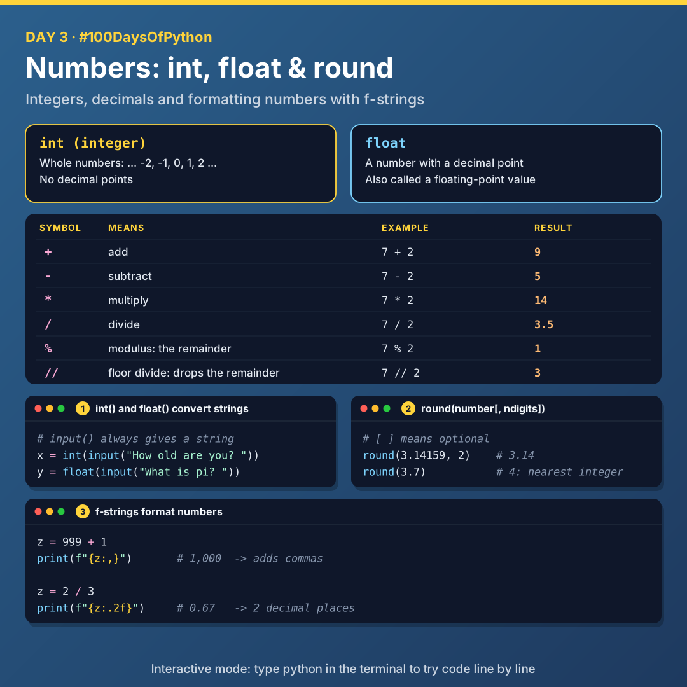
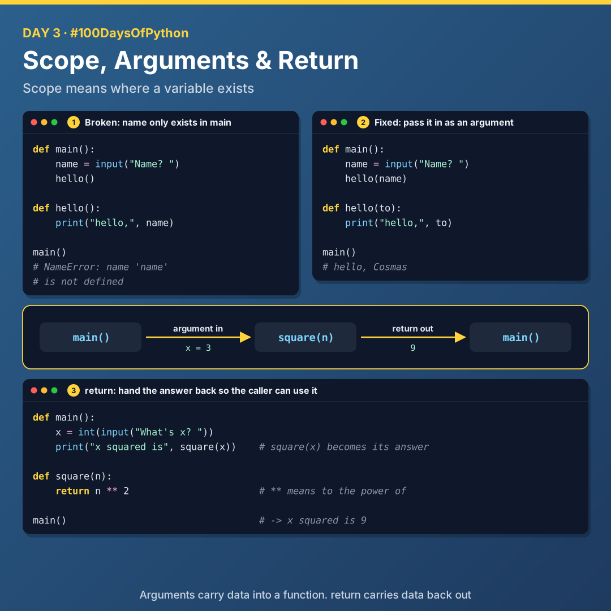

# Day 3: Numbers, Scope and Return

Today I learnt how Python handles numbers (integers and floats), how to round and format them, and how scope decides where a variable exists.



## Interactive mode

To try code line by line, run the `python` command on its own in the terminal. That opens interactive mode.

## Integers (int)

`int` stands for **integer**: whole numbers like -2, -1, 0, 1, 2, all the way towards negative and positive infinity. There are no decimal points in integers.

| Symbol | Meaning | Example | Result |
|--------|---------|---------|--------|
| `+` | Add | `7 + 2` | `9` |
| `-` | Subtract | `7 - 2` | `5` |
| `*` | Multiply | `7 * 2` | `14` |
| `/` | Divide | `7 / 2` | `3.5` |
| `%` | Modulus: the remainder after division | `7 % 2` | `1` |
| `//` | Floor divide: drops the remainder after division | `7 // 2` | `3` |

### int() converts strings to numbers

`input()` always returns a string. `int()` is also a function, and it converts strings that look like numbers into actual numbers.

```python
x = int(input("How old are you? "))
```

## Floats

A **float** is a number with a decimal point, also known as a floating-point value.

```python
x = float(input("What is pi? "))
```

## round

From the Python documentation:

```python
round(number[, ndigits])
```

- The first argument is the number to round.
- The **square brackets mean optional**. `ndigits` is the number of digits to round to, added after a comma (for example `2` for two decimal places).
- If you don't specify a number of digits, it rounds to the nearest integer.

```python
round(3.14159, 2)   # 3.14
round(3.7)          # 4
```

## f-strings with numbers

f-strings can format numbers too:

```python
z = 999 + 1
print(f"{z:,}")      # 1,000  (adds commas)

z = 2 / 3
print(f"{z:.2f}")    # 0.67   (2 decimal places)
```

## Scope



**Scope means where a variable exists.** A variable created inside a function only exists inside that function.

```python
def main():
    name = input("What's your name? ")
    hello()

def hello():
    print("hello,", name)   # NameError: name 'name' is not defined

main()
```

`name` was created inside `main`, so `hello` can't see it.

### The fix: pass it as an argument

```python
def main():
    name = input("What's your name? ")
    hello(name)

def hello(to):
    print("hello,", to)

main()
```

## Return

```python
def main():
    x = int(input("What's x? "))
    print("x squared is", square(x))

def square(n):
    return n ** 2

main()
```

`square` doesn't print anything. It **returns** the answer, and `square(x)` is replaced by that value back in `main`. (`**` means "to the power of".)

> **Arguments carry data into a function. `return` carries data back out.**

## Files

| File | What it covers |
|------|----------------|
| [`01_integers.py`](./01_integers.py) | `+ - * / % //` with integers |
| [`02_calculator.py`](./02_calculator.py) | Converting input with `int()` |
| [`03_floats_round.py`](./03_floats_round.py) | `float()` and `round()` |
| [`04_format_numbers.py`](./04_format_numbers.py) | f-strings with `:,` and `:.2f` |
| [`05_scope_broken.py`](./05_scope_broken.py) | The `NameError` (crashes on purpose) |
| [`06_scope_fixed.py`](./06_scope_fixed.py) | Passing data in as an argument |
| [`07_square_return.py`](./07_square_return.py) | Returning a value |

## Key takeaways

- `input()` gives you a string. Use `int()` or `float()` to do maths with it.
- `/` gives a decimal, `//` drops the remainder, `%` keeps only the remainder.
- Square brackets in the docs mean an argument is optional.
- A variable lives only inside the function that created it.
- Arguments in, `return` out.

---

[Back to all days](../README.md)
