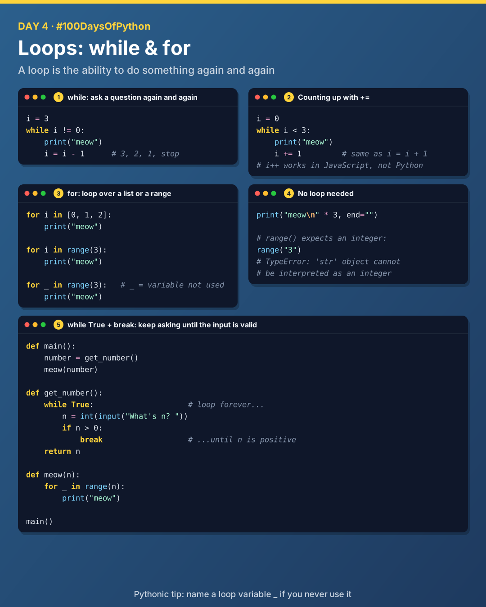
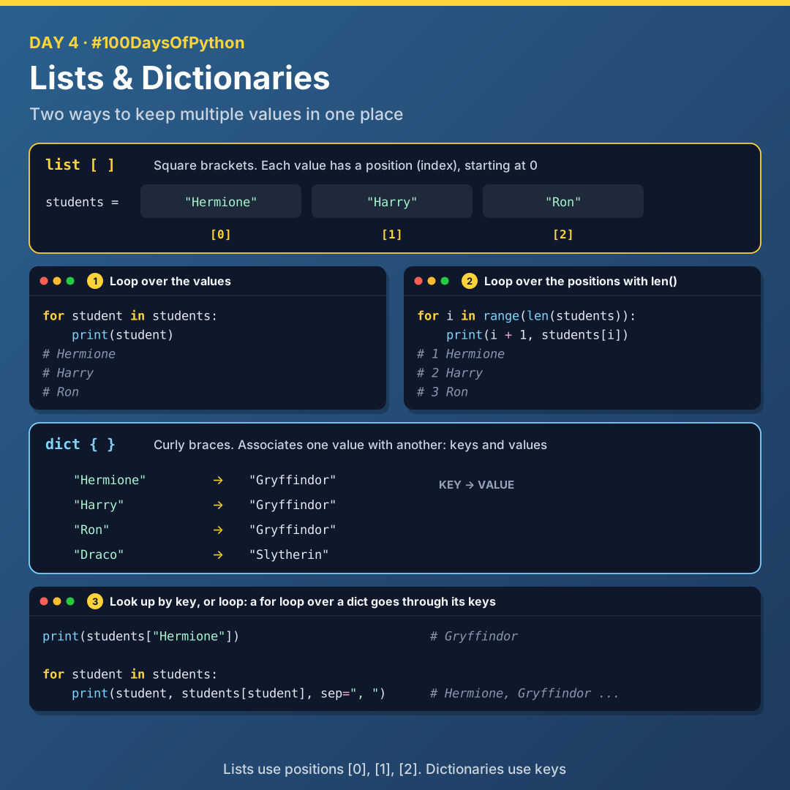

# Day 4: Loops, Lists and Dictionaries

Today I learnt how to repeat code with `while` and `for` loops, and how to keep many values in one place with lists and dictionaries.



## Loops

A **loop** is the ability to do something again and again: to repeat something.

### while

`while` lets us ask a question again and again. The loop keeps running as long as the condition is `True`.

```python
i = 3
while i != 0:
    print("meow")
    i = i - 1
```

How it flows: start → `i = 3` → is `i != 0`? **True** → print meow → `i = i - 1` → ask again. When `i` reaches 0 the answer is **False**, and the loop stops.

Counting up instead:

```python
i = 0
while i < 3:
    print("meow")
    i += 1
```

`i += 1` adds one every time. It's the same as `i = i + 1`. (JavaScript has `i++`, but Python doesn't.)

### for

A `for` loop goes through each value in a list, one at a time.

```python
for i in [0, 1, 2]:
    print("meow")

for i in range(3):
    print("meow")

for _ in range(3):
    print("meow")
```

> **Pythonic tip:** if you're not using the loop variable again (like `i` above), name it with an underscore `_`.

Sometimes you don't need a loop at all:

```python
print("meow\n" * 3, end="")
```

### while True and break

`while True` loops forever, until `break` stops it. Here it keeps asking until the user types a positive number:

```python
def main():
    number = get_number()
    meow(number)

def get_number():
    while True:
        n = int(input("What's n? "))
        if n > 0:
            break
    return n

def meow(n):
    for _ in range(n):
        print("meow")

main()
```

> `range()` expects an integer and doesn't accept strings.

## Lists



A **list** is a type of data in Python: a way of keeping multiple values in the same place. Lists use square brackets `[ ]`, and each value has a position (index) starting at 0.

```python
students = ["Hermione", "Harry", "Ron"]
#              [0]        [1]      [2]
```

Two ways to loop over it:

```python
for student in students:
    print(student)
```

```python
for i in range(len(students)):
    print(i + 1, students[i])
```

`len()` gives the length of the list, which `range()` can use.

## Dictionaries (dict)

A **dict** (dictionary) is a data structure that associates one value with another: **keys and values**. Dictionaries use curly braces `{ }`.

```python
students = {
    "Hermione": "Gryffindor",
    "Harry": "Gryffindor",
    "Ron": "Gryffindor",
    "Draco": "Slytherin",
}

print(students["Hermione"])   # Gryffindor
```

When you use a `for` loop on a dictionary, by design it goes through all the **keys**:

```python
for student in students:
    print(student, students[student], sep=", ")
```

## Files

| File | What it covers |
|------|----------------|
| [`01_while_loop.py`](./01_while_loop.py) | Counting down and up with `while` |
| [`02_for_loop.py`](./02_for_loop.py) | `for` with a list, `range()` and `_` |
| [`03_meow_functions.py`](./03_meow_functions.py) | `while True`, `break` and functions |
| [`04_lists.py`](./04_lists.py) | Lists, indexes and `len()` |
| [`05_dictionaries.py`](./05_dictionaries.py) | Keys, values and looping over a dict |

## Key takeaways

- `while` repeats as long as a condition is `True`, so make sure it eventually becomes `False`.
- `for` goes through a list or a `range()` one value at a time.
- `while True` + `break` is a clean way to keep asking until the input is valid.
- Lists are found by position, dictionaries by key.

---

[Back to all days](../README.md)
